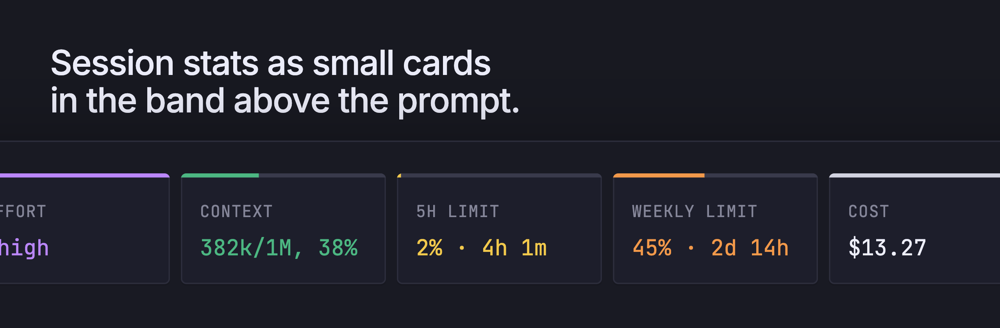

# claude-mods

Claude Code mods I made for my own setup.

## session-cards

Session stats as small cards in the band above the prompt. I made it to replace ccstatusline with a native mod.



- git shows the current branch
- model is the session model
- effort is the effort level from your settings, the model setting first and then the global one
- context is how full the context window is, the top line works as a progress bar
- 5h limit is how much of the 5 hour window you used and when it resets, with a bar too
- weekly limit is the same for the weekly window
- cost is the session cost in dollars, same number as `/cost`. On Max it's just for reference

Everything refreshes every 5 seconds and after each turn. When the terminal is narrow the cards wrap to the next line and keep their width.

### Install

Type this at the prompt of a Claude Code terminal session:

```
/plugin install session-cards --marketplace alan-oliv/claude-mods
```

Answer `y` to add the marketplace and pick a scope. It starts working right away.

### Notes

Mods are early access in Claude Code and I built this one on 2.1.296, so a new release can break it. If something looks off, open an issue and I'll take a look.

Context and limits stay empty until the session gets its first reply from the API, there is nothing to read before that.
