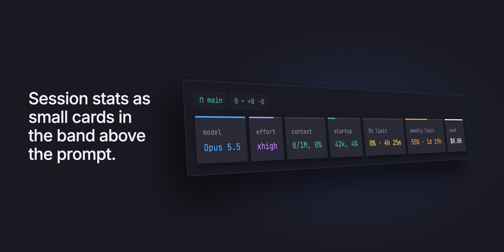

# claude-mods

Claude Code mods I made for my own setup.

---

### Session stats



- branch and session sit on one line above the cards. branch is a badge with the current git branch, next to a badge with the files and lines changed since the last commit. session is the name from `/rename` or `--name`. After a `/rename` the name updates on your next prompt
- model is the session model
- effort is the effort level from your settings, the model setting first and then the global one. The bar fills by level, from low to max
- context is how full the context window is, the top line works as a progress bar
- startup is how much of the context window the session takes before your first prompt: system prompt, tools, MCP, skills, agents and memory files. It's measured again after each turn, so an MCP server that connects late shows up. It's green under 10% of the window, yellow up to 20% and red past that, when the bar is full
- 5h limit is how much of the 5 hour window you used and when it resets, with a bar too
- weekly limit is the same for the weekly window
- cost is the session cost in dollars, same number as `/cost`. On Max it's just for reference

Everything refreshes every 5 seconds and after each turn. When the terminal is narrow the cards wrap to the next line and keep their width.

Every card, the branch and the session name can be turned off in `/config`, they all start on.

### Install

Type this at the prompt of a Claude Code terminal session:

```
/plugin install session-cards --marketplace alan-oliv/claude-mods
```

Answer `y` to add the marketplace and pick a scope. It starts working right away.

### Turning cards off

Open `/config` and type `session-cards` to filter the list:

```
  ╭─────────────────────────────────────────────────╮
  │ ⌕ session-cards                                 │
  ╰─────────────────────────────────────────────────╯

  ❯ Show branch · session-cards             true
    Show session name · session-cards       true
    Show model card · session-cards         true
    Show effort card · session-cards        true
    Show context card · session-cards       true
    Show startup card · session-cards       true
    Show 5h limit card · session-cards      true
    Show weekly limit card · session-cards  true
    Show cost card · session-cards          true

  Enter/Space to change · / to search · Esc to close
```

Move to a row and press Enter or Space to switch it between `true` and `false`. It applies right away, no restart needed.

### Notes

Mods are early access in Claude Code and I built this one on 2.1.296, so a new release can break it. If something looks off, open an issue and I'll take a look.

Context and limits stay empty until the session gets its first reply from the API, there is nothing to read before that.
